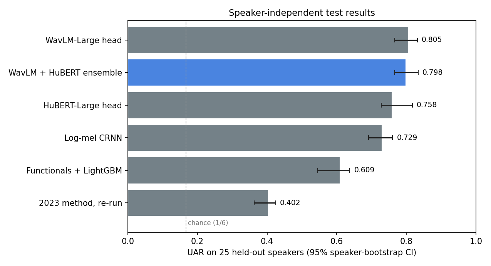
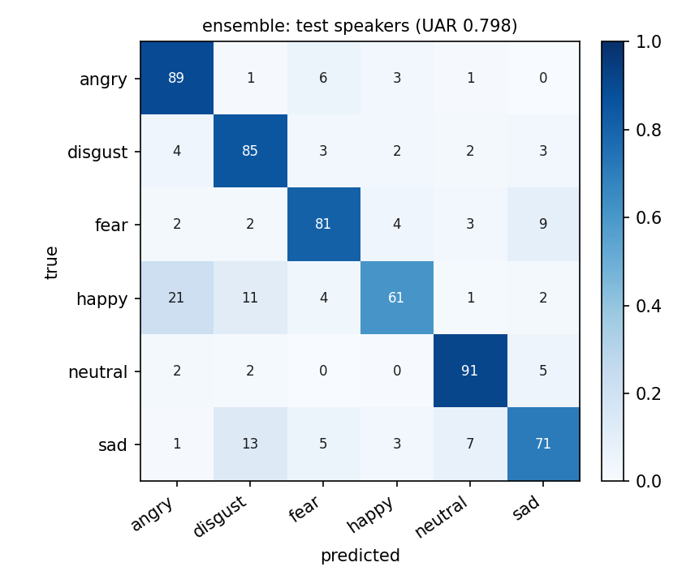
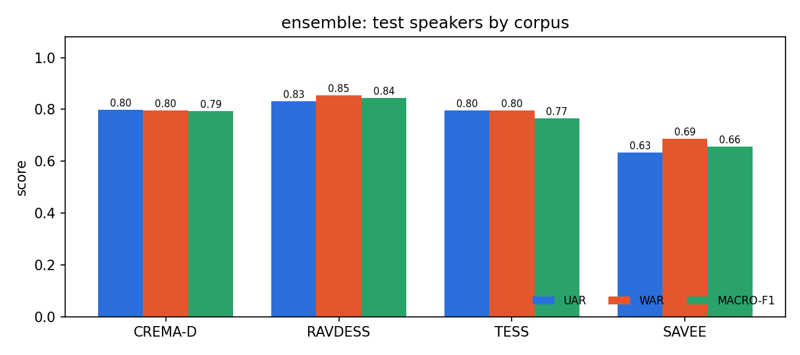
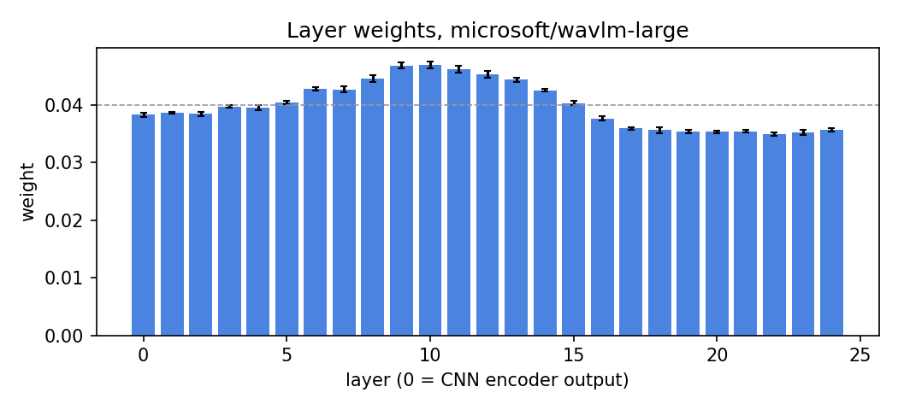
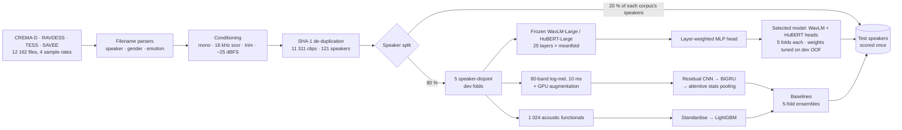
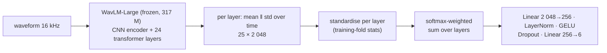
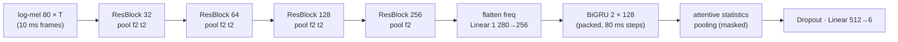

<div align="center">

# AUM2 · Speech Emotion Recognition

**Six-emotion recognition from the voice, evaluated on speakers the model has never heard**<br>
frozen WavLM-Large + HuBERT-Large · layer-weighted heads · log-mel CRNN · leak-free speaker-independent protocol

[](https://github.com/Baraa-Melhem/AUM2/actions/workflows/ci.yml)


[](https://github.com/astral-sh/ruff)
[](LICENSE)
[](https://www.kaggle.com/code/baraamelhem/audio-emotional-classification)

</div>

<p align="center">
  
</p>

**Headline (25 speakers never seen in training or model selection, 2 994 clips, six emotions):**
the selected model, an ensemble of two frozen self-supervised speech models (WavLM-Large +
HuBERT-Large) with learned layer-weighted heads, reaches **0.798 UAR / 79.6 % accuracy**
(95 % speaker-bootstrap CI 0.767–0.834). WavLM-Large alone scores 0.805; the two are statistically
indistinguishable (p = 0.42). The 2023 notebook's method, re-run under the same protocol, scores
**0.402**: the 87–100 % accuracies it reported came from data leakage ([audit](AUDIT.md)). A 2.2 M-parameter
log-mel CRNN trained from scratch reaches 0.729 and runs in ~60 ms per clip on a laptop GPU.

---

## Contents

1. [What changed since 2023](#what-changed-since-2023)
2. [Results](#results)
3. [Methodology](#methodology)
4. [Quickstart](#quickstart)
5. [Repository layout](#repository-layout)
6. [Reproducing every number](#reproducing-every-number)
7. [Limitations and responsible use](#limitations-and-responsible-use)
8. [Data, licences and citation](#data-licences-and-citation)

---

## What changed since 2023

The 2023 version of this project (the [Kaggle notebook](https://www.kaggle.com/code/baraamelhem/audio-emotional-classification)
and the `AUM2.py` voice assistant, both kept in [`legacy/`](legacy/)) reported 61–90 % validation
accuracy for its five sub-models and 95.5–100 % "test" accuracy per emotion. A line-by-line audit ([`AUDIT.md`](AUDIT.md)) found that
those numbers measure memorisation, not emotion recognition:

| # | Issue in the 2023 code | Consequence | Fix in this repository |
|---|---|---|---|
| 1 | The "test" clips (TESS) were part of the training set (`audio-emotions` already contains all of TESS) | The 95.5–100 % table is training accuracy | Held-out **test speakers**, never seen in training or model selection |
| 2 | CREMA-D and SAVEE were added a second time on top of `audio-emotions` | 7 922 exact duplicates, split randomly across train/validation | Corpora parsed once from the original releases; SHA-1 de-duplication of the conditioned audio |
| 3 | `"a" in filename` tested on the full `/kaggle/...` path | **All 480 SAVEE clips labelled "angry"** (the `a` is in "kaggle") | Anchored regular expressions on the bare file name, with regression tests |
| 4 | Augmented and duplicated clips created *before* the split | More near-duplicate leakage; silent class re-weighting | Augmentation is a random function of each *training* batch, on the GPU, never stored |
| 5 | Random utterance-level split | The same speaker and sentence on both sides; speaker identity becomes a shortcut | `StratifiedGroupKFold` by speaker; leakage measured explicitly (below) |
| 6 | Native sample rates (16–48 kHz) and every clip resized to 128×128 | Mel axis means something different per corpus; speaking rate destroyed; a 20 s live recording squeezed 10× more than training clips | One 16 kHz pipeline, variable-length inputs with masking; long recordings analysed in windows |
| 7 | Power mel spectrogram, no log, no normalisation | 10⁸ dynamic range; recording gain becomes a corpus cue | Log-mel, −25 dBFS loudness normalisation, per-band standardisation fitted on the training fold |
| 8 | One Conv(16) layer feeding a 2-million-weight dense layer; no regularisation | Position-specific, heavily over-fitted features | Residual CNN → BiGRU → attentive pooling; frozen WavLM-Large with a learned layer mix |
| 9 | Five hard-routed models in a cascade | Errors compound; "positive" branch can output Angry/Sad; reported confidence belongs to the last sub-model | One calibrated 6-way classifier per model, ensembled over folds |
| 10 | Accuracy only, no seeds | No UAR, F1, confusion matrix or uncertainty; not reproducible | UAR/WAR/F1/AUC/ECE, per-class and per-corpus, speaker-bootstrap CIs, paired significance tests, fixed seeds |
| 11 | Hard-coded `C:\Users\...` paths, copy-pasted cells, cloud speech API, model on Google Drive | Runs on one machine only | Typed package, YAML configs, CLIs, offline inference, 66 tests, CI |

The audit also surfaced a defect in the **source data**: CREMA-D ships three pairs of byte-identical
recordings with *different* emotion labels (e.g. `1006_TIE_HAP_XX.wav` = `1006_TIE_NEU_XX.wav`).
AUM2 drops those pairs, because their true label cannot be known.

---

## Results

All numbers come from [`reports/benchmark.md`](reports/benchmark.md), regenerated by
`python evaluate.py --benchmark ...`. Each model is trained five times (once per dev fold); **test**
scores are for the five-model ensemble on the 25 held-out speakers, **dev OOF** is the
out-of-fold score on the other 96 speakers, and **single-model** is the mean ± sd of the five fold
models on test. Chance is 0.167.

| Model | Dev OOF UAR | Test UAR [95% CI] | Test WAR | Test macro-F1 | Single-model test UAR | CREMA-D | RAVDESS | TESS | SAVEE |
|---|---:|---|---:|---:|---:|---:|---:|---:|---:|
| **WavLM + HuBERT ensemble** (selected) | **0.792** | **0.798** [0.767, 0.834] | 0.796 | 0.794 | 0.781 ± 0.042 | 0.799 | 0.832 | 0.796 | 0.633 |
| WavLM-Large head | 0.770 | 0.805 [0.767, 0.832] | 0.804 | 0.801 | 0.781 ± 0.048 | 0.796 | 0.849 | 0.815 | 0.644 |
| HuBERT-Large head | 0.774 | 0.758 [0.728, 0.818] | 0.757 | 0.756 | 0.744 ± 0.041 | 0.783 | 0.832 | 0.721 | 0.600 |
| Log-mel CRNN (from scratch) | 0.656 | 0.729 [0.691, 0.761] | 0.727 | 0.725 | 0.689 ± 0.046 | 0.726 | 0.786 | 0.737 | 0.467 |
| 1 024 functionals + LightGBM | 0.535 | 0.609 [0.546, 0.638] | 0.609 | 0.609 | 0.581 ± 0.023 | 0.598 | 0.522 | 0.652 | 0.350 |
| 2023 method, re-run honestly | 0.353 | 0.402 [0.363, 0.424] | 0.400 | 0.406 | 0.368 ± 0.052 | 0.407 | 0.343 | 0.417 | 0.194 |

**Which differences are real?** Paired speaker-bootstrap tests on the test speakers
(`evaluate.py --compare`, 2 000 resamples of whole speakers):

| Comparison | ΔUAR | 95% CI | p |
|---|---:|---|---:|
| ensemble − WavLM | −0.007 | [−0.015, +0.007] | 0.42 |
| WavLM − HuBERT | +0.047 | [+0.006, +0.071] | 0.003 |
| WavLM − CRNN | +0.076 | [+0.059, +0.090] | < 0.001 |
| CRNN − functionals | +0.121 | [+0.101, +0.164] | < 0.001 |
| functionals − 2023 method | +0.206 | [+0.173, +0.224] | < 0.001 |
| ensemble − 2023 method | +0.395 | [+0.375, +0.434] | < 0.001 |

Two honest caveats:

* **Dev and test disagree at the top.** On the 96 dev speakers the ensemble is clearly best
  (0.792 vs 0.770 OOF UAR) and was selected there, before the test set was scored. On the 25 test
  speakers WavLM alone is 0.007 higher, which is not significant. The ensemble stays the reported
  model; picking WavLM now would mean choosing on the test set. `predict.py` defaults to the
  single WavLM run because it needs one backbone instead of two and is statistically as good.
* **Dev OOF is lower than test for most models.** That is expected here: dev fold 0 holds the only
  dev TESS speaker, so it is scored by models that never heard TESS (a cross-corpus test), while 4
  of the 5 fold models scoring the test TESS speaker did train on TESS.

### How much did the 2023 protocol inflate the numbers?

The same pipelines, re-trained and re-scored under the 2023 protocol: a random *utterance-level*
split, so the same speakers and sentences appear in training and test. This isolates the speaker
leak alone; the duplicated corpora and test-in-train data of the original notebook come on top.

| Model | Random split (2023 protocol) | Speaker-independent | Inflation |
|---|---:|---:|---:|
| WavLM-Large head | 0.877 | 0.805 | +7.2 points |
| 2023 method | 0.534 | 0.402 | +13.2 points |

Under the random split TESS reaches **1.000** UAR, which is how the 2023 notebook could report
95.5–100 % per emotion.

### Diagnostics (selected model, test speakers)

<p align="center">
  
  
</p>

| Emotion | Precision | Recall | F1 |
|---|---:|---:|---:|
| angry | 0.750 | 0.891 | 0.815 |
| disgust | 0.749 | 0.854 | 0.798 |
| fear | 0.817 | 0.812 | 0.815 |
| happy | 0.832 | 0.608 | 0.703 |
| neutral | 0.855 | 0.914 | 0.884 |
| sad | 0.801 | 0.708 | 0.751 |

Macro ROC-AUC 0.964, macro PR-AUC 0.879, log-loss 0.627, expected calibration error 0.074 after
per-fold temperature scaling.

* **Happy is the weak class, and the cause is one speaker.** 112 of the 200 *happy* clips of TESS's
  older speaker (OAF, aged 64) are predicted *disgust*; CREMA-D *happy* recall is 0.87. A single
  training voice for TESS cannot cover the other.
* **SAVEE is hardest** (0.63): one held-out speaker, 105 clips, and only three male SAVEE voices to
  learn from. Its interval is the widest.
* **WavLM listens to its middle layers.** The learned layer weights peak at transformer layers 6–14
  and fall off towards the top, the known profile of paralinguistic information in SSL models:

<p align="center">
  
</p>

More figures for every run, including ROC and PR curves, reliability diagrams and training curves,
are in [`reports/runs/`](reports/runs/).

### Inference speed

Fold ensemble of five models, RTX 3050 Laptop GPU or 12-thread CPU, including conditioning:

| Run | Device | One 2.3 s clip | 30 s recording (18 windows) |
|---|---|---:|---:|
| `crnn` | GPU | 63 ms | 0.28 s |
| `crnn` | CPU | 246 ms | 2.5 s |
| `wavlm` | GPU | 91 ms | 1.6 s |
| `wavlm` | CPU | 795 ms | 16.7 s |
| `ensemble` | GPU | 144 ms | 2.4 s |

---

## Methodology

### Pipeline



### Data

| Corpus | Speakers | Clips used | Hours | Native rate | Emotions kept |
|---|---|---:|---:|---|---|
| [CREMA-D](https://github.com/CheyneyComputerScience/CREMA-D) | 91 actors (48 m, 43 f) | 7 436 | 5.13 | 16 kHz | all 6 |
| [RAVDESS](https://zenodo.org/records/1188976) (speech) | 24 actors (12 m, 12 f) | 1 055 | 0.63 | 48 kHz | 6 of 8 (calm, surprise dropped) |
| [TESS](https://doi.org/10.5683/SP2/E8H2MF) | 2 actresses (26 and 64 y) | 2 400 | 1.37 | 24.4 kHz | 6 of 7 (surprise dropped) |
| [SAVEE](http://kahlan.eps.surrey.ac.uk/savee/) | 4 male speakers | 420 | 0.44 | 44.1 kHz | 6 of 7 (surprise dropped) |
| **Total** | **121** | **11 311** | **7.57** | → 16 kHz | angry, disgust, fear, happy, neutral, sad |

The six classes are the ones all four corpora share, and the ones the 2023 project used. Classes
are near-balanced (1 702 neutral, 1 921–1 922 for each of the others) and still re-weighted inversely
to their training-fold frequency.

### Evaluation protocol

* **Test:** 20 % of the speakers of *each* corpus, drawn per gender with a fixed seed: 18 CREMA-D
  actors, 5 RAVDESS actors, SAVEE speaker KL and TESS speaker OAF (2 994 clips). They are scored once,
  by the ensemble of the five fold models.
* **Dev:** the other 96 speakers, in five speaker-disjoint folds (`StratifiedGroupKFold`, groups =
  speaker, strata = corpus × emotion). Every hyper-parameter was chosen on dev **out-of-fold UAR**
  with `tune.py`, which never loads the test speakers ([`reports/model_selection.md`](reports/model_selection.md)).
* **Fit on training rows only:** feature standardisation, scalers, class weights and SSL-layer
  statistics are all fitted inside each fold. Neural models train for a fixed cosine schedule and keep
  the final EMA weights; no epoch is picked on validation data.
* **Metrics:** UAR (mean per-class recall, the standard SER headline), WAR (accuracy), macro- and
  weighted-F1, per-class precision/recall/F1, one-vs-rest ROC-AUC and PR-AUC, log-loss and expected
  calibration error. Confidence intervals come from a **speaker-level bootstrap** (whole speakers are
  resampled, because clips of one speaker are correlated), and model comparisons use a paired
  speaker bootstrap (`evaluate.py --compare`).

### Acoustic front end

Every waveform, in training and at inference, goes through
[`aum2.data.audio.condition`](src/aum2/data/audio.py):

1. **down-mix and resample** to 16 kHz with soxr (VHQ);
2. **trim** edge silence quieter than the loudest 25 ms frame minus 35 dB, keeping a 100 ms margin;
3. **normalise loudness** to −25 dBFS RMS, with a peak guard at 0.99.

Then, per model family:

| Family | Representation |
|---|---|
| SSL head | Every hidden layer (25 for the Large models) of a **frozen** WavLM-Large / HuBERT-Large, summarised by its mean and standard deviation over time → `25 × 2 048` per clip, cached once (1.2 GB float16) |
| CRNN | **80-band log-mel** energies (25 ms Hann, 10 ms hop, 20 Hz–8 kHz, Slaney filters), standardised per band with training-fold statistics stored *inside* the checkpoint |
| Classical | **1 024 functionals** (mean, std, min, p10, median, p90, max) of 40 MFCCs + Δ + ΔΔ, chroma, spectral contrast, centroid, bandwidth, roll-off, flatness, ZCR, RMS energy and voiced-frame F0 (YIN), plus voiced ratio and duration |

**Augmentation** (CRNN, training batches only, on the GPU): random 3 s crops, ±6 dB gain, white/pink/brown
noise at 10–35 dB SNR, tempo perturbation ×0.85–1.15 and vocal-tract-length perturbation ×0.9–1.1
(per-sample resampling of the time and mel axes), then SpecAugment (2 frequency masks ≤ 12 bands,
2 time masks ≤ 10 %).

### Models

**Layer-weighted SSL head**: the paralinguistic information in WavLM peaks in the middle layers, not
the last one, so the head learns which layers to listen to:



**Log-mel CRNN** (2.17 M parameters): variable-length input, masks carried through every layer so a
clip gives identical logits alone or in a padded batch (unit-tested):



**Legacy cascade**: a faithful PyTorch port of the 2023 method (128×128 resized power mel at native
sample rate, five one-layer CNNs, the original routing and training recipe), trained and scored under
the same protocol, so the "before" number is measured rather than quoted.

### Training

AdamW (decoupled weight decay, none on biases and norms), linear warm-up then cosine decay per step,
fp16 autocast with gradient scaling, gradient-norm clipping at 5, an exponential moving average of the
weights (decay 0.999 with warm-up), cross-entropy with label smoothing 0.1 and inverse-frequency class
weights. Focal loss and early stopping are available as options (`train.loss: focal`,
`train.patience`) but were not selected. Seeds are fixed for Python, NumPy and PyTorch; bit-exact
cuDNN kernels are opt-in (`train.deterministic: true`) because they cost ~10× in speed.

---

## Quickstart

```bash
git clone https://github.com/Baraa-Melhem/AUM2.git
cd AUM2
# CUDA users: install torch for your CUDA version first (https://pytorch.org/get-started/locally/)
pip install -e ".[dev,mic]"
```

**Predict with the released models** (download `aum2-models.zip` from the
[latest release](https://github.com/Baraa-Melhem/AUM2/releases) and unzip it into `runs/`; the
WavLM-Large backbone is fetched from Hugging Face on first use):

```bash
python predict.py path/to/recording.wav
python predict.py long_interview.wav --json
python predict.py --run runs/ensemble path/to/recording.wav
python predict.py --mic 5
python predict.py --mic 4 --loop
```

```text
1004_TSI_ANG_XX.wav: angry (95.8%) over 2.4 s
  angry     95.8% #############################
  fear       1.8% #
  disgust    1.1%
  neutral    0.5%
  happy      0.4%
  sad        0.3%
```

`--run runs/ensemble` uses the selected WavLM + HuBERT ensemble (two backbones, about 1.6× slower);
`--run runs/crnn` uses the 2.2 M-parameter CRNN, which needs no download beyond the release.

Recordings longer than 6 s are cut into 3 s windows (1.5 s hop), silent windows are skipped, and a
per-window timeline is printed. Audio never leaves the machine.

**Python API**

```python
from aum2.inference import EmotionRecognizer

recognizer = EmotionRecognizer("runs/wavlm")  # or runs/crnn for a 2 M-parameter model
prediction = recognizer.predict_file("clip.wav")
print(prediction.label, prediction.confidence, prediction.probabilities)
for segment in prediction.segments:  # only for long recordings
    print(segment.start, segment.end, segment.label)
```

**Train from scratch**

```bash
python download_data.py --prepare               # ~1.1 GB download (1.5 GB on disk) + 0.8 GB 16 kHz cache
python train.py --config configs/wavlm.yaml      # one-off WavLM feature extraction, then seconds per fold
python train.py --config configs/crnn.yaml       # ~1.5 h on an RTX 3050
python evaluate.py --benchmark runs/wavlm runs/crnn runs/handcrafted runs/legacy
```

Any config value can be overridden from the command line, e.g.
`python train.py --config configs/crnn.yaml --set train.epochs=30 augment.noise_prob=0.3`.

---

## Repository layout

```text
AUM2/
├── configs/                 YAML experiments (base.yaml + one file per model / protocol)
├── src/aum2/
│   ├── config.py            typed, validated dataclass config; YAML inheritance and --set overrides
│   ├── data/
│   │   ├── corpora.py       anchored filename parsers for the four corpora
│   │   ├── download.py      pinned, resumable downloads from the original sources
│   │   ├── audio.py         load → resample → trim → loudness-normalise (train = serve)
│   │   ├── dataset.py       manifest, parallel conditioning, int16 cache, label-aware de-duplication
│   │   └── splits.py        speaker-independent test split and speaker-disjoint folds
│   ├── features/
│   │   ├── frontend.py      GPU log-mel with in-checkpoint normalisation (padding-invariant)
│   │   ├── augment.py       batched GPU augmentation: gain, noise, tempo, VTLP, SpecAugment
│   │   ├── handcrafted.py   1 024 acoustic functionals
│   │   └── ssl.py           frozen WavLM/HuBERT per-layer statistics, resumable cache
│   ├── models/              CRNN, layer-weighted SSL head, legacy cascade, masked layers
│   ├── training/
│   │   ├── engine.py        AdamW · warm-up + cosine · AMP · clipping · EMA · early stopping
│   │   ├── losses.py        class-weighted cross-entropy / focal loss
│   │   ├── learners.py      one interface over the four model families
│   │   ├── experiment.py    resumable 5-fold CV + held-out test scoring
│   │   └── selection.py     dev-only grid search (never touches the test speakers)
│   ├── evaluation/          metrics, speaker bootstrap, plots, reports, ensembles
│   ├── inference.py         EmotionRecognizer: files, arrays, microphone, long-audio windows
│   └── cli/                 entry points behind the root scripts
├── tests/                   66 tests on a synthetic four-corpus fixture (CI runs them on CPU)
├── notebooks/AUM2_showcase.ipynb   narrative walkthrough with executed outputs
├── reports/                 benchmark table, model-selection log, figures
├── legacy/                  the 2023 script and notebook, for reference
├── download_data.py · train.py · evaluate.py · predict.py · tune.py
└── AUDIT.md                 the full audit of the 2023 code
```

---

## Reproducing every number

Every number in this README comes from `runs/<name>/metrics.json`, and the per-run reports are
copied to [`reports/runs/`](reports/runs/). Timings are for an RTX 3050 6 GB laptop GPU and a
12-thread CPU.

```bash
python download_data.py --prepare                 # corpora + conditioned 16 kHz cache (~20 s after download)

# model selection: dev folds only (reports/model_selection.md)
python tune.py --config configs/wavlm.yaml --grid train.epochs=6,10,14 model.ssl.dropout=0.5,0.7 train.learning_rate=0.0005,0.001
python tune.py --config configs/handcrafted.yaml --set model.handcrafted.classifier=lightgbm --grid model.handcrafted.lgbm_num_leaves=15,31

# final runs: 5-fold dev CV + held-out test speakers
python train.py --config configs/wavlm.yaml        # WavLM-Large features ~10 min once, then ~1 min
python train.py --config configs/hubert.yaml       # HuBERT-Large features ~10 min once, then ~1 min
python train.py --config configs/crnn.yaml         # ~1.5 h
python train.py --config configs/handcrafted.yaml  # ~2 min of features, ~6 min of LightGBM
python train.py --config configs/legacy.yaml       # the 2023 method, re-run honestly
python train.py --config configs/legacy_random.yaml   # ... and under the 2023 random split
python train.py --config configs/wavlm_random.yaml    # best model under the 2023 random split

# ensemble with weights tuned on dev OOF, benchmark table + figures, significance test
python evaluate.py --ensemble runs/wavlm runs/hubert runs/crnn --name ensemble --tune-weights
python evaluate.py --benchmark runs/ensemble runs/wavlm runs/hubert runs/crnn runs/handcrafted runs/legacy
python evaluate.py --export runs/wavlm_random runs/legacy_random
python evaluate.py --compare runs/ensemble runs/wavlm
```

Runs are resumable: an interrupted `train.py` skips folds that already finished, and it refuses
to reuse a run folder trained with different settings. Seeds are fixed (`seed`, `split.seed`);
GPU kernels are not bit-exact unless `--set train.deterministic=true`.

---

## Limitations and responsible use

* **Acted, English, studio speech.** All four corpora are actors reading fixed sentences in quiet
  rooms. Spontaneous emotion is subtler and often mixed; expect lower accuracy on real conversations,
  other languages and noisy channels.
* **Few speakers in two corpora.** TESS has two speakers and SAVEE four, so their test scores rest on a
  single held-out voice each and swing widely (see the confidence intervals). CREMA-D, with 18 test
  speakers, is the most trustworthy number.
* **Female speakers are recognised better than male ones.** Within CREMA-D the ensemble's UAR is
  0.83 for the 9 female and 0.77 for the 9 male test speakers (0.82 vs 0.78 over 73 dev speakers),
  and the same direction holds in RAVDESS. Across corpora the gap is confounded (TESS is all
  female, SAVEE all male), but within corpora it is consistent. Treat the system as less reliable
  for male voices.
* **Six categorical labels.** Real affect is continuous (arousal/valence) and context-dependent. A label
  such as "angry" describes how a clip *sounds* to annotators, not what the speaker feels.
* **Not for consequential decisions.** Emotion recognition is unreliable across individuals, cultures
  and medical conditions. Do not use it to assess people in hiring, education, policing, healthcare
  or similar settings. Inference runs locally, and recordings of people should only be analysed with
  their consent.

---

## Data, licences and citation

The **code** is released under the [GNU GPL v2](LICENSE), as was the original repository. The
**datasets are not redistributed**; `download_data.py` fetches them from their publishers. Their terms
carry over to anything trained on them, so the **released model weights are for non-commercial
research use only** (RAVDESS: CC BY-NC-SA 4.0; TESS: CC BY-NC 4.0; CREMA-D: ODbL / DbCL; SAVEE:
research use). SAVEE's official site requires registration, so `download_data.py` reads the original
`DC_a01.wav`-style files from a public Hugging Face mirror
([`AbstractTTS/SAVEE`](https://huggingface.co/datasets/AbstractTTS/SAVEE), pinned revision), stored there at 16 kHz.

* Cao, H., Cooper, D. G., Keutmann, M. K., Gur, R. C., Nenkova, A., & Verma, R. (2014). CREMA-D:
  Crowd-sourced emotional multimodal actors dataset. *IEEE Transactions on Affective Computing*, 5(4), 377–390.
* Livingstone, S. R., & Russo, F. A. (2018). The Ryerson Audio-Visual Database of Emotional Speech and
  Song (RAVDESS). *PLoS ONE*, 13(5), e0196391.
* Dupuis, K., & Pichora-Fuller, M. K. (2010). *Toronto emotional speech set (TESS)*. University of Toronto.
  doi:10.5683/SP2/E8H2MF
* Haq, S., & Jackson, P. J. B. (2010). Multimodal emotion recognition. In *Machine Audition: Principles,
  Algorithms and Systems*, 398–423. (SAVEE)
* Chen, S. et al. (2022). WavLM: Large-scale self-supervised pre-training for full stack speech
  processing. *IEEE JSTSP*, 16(6), 1505–1518.
* Hsu, W.-N. et al. (2021). HuBERT: Self-supervised speech representation learning by masked
  prediction of hidden units. *IEEE/ACM TASLP*, 29, 3451–3460.

```bibtex
@software{melhem_aum2,
  author = {Melhem, Al-Baraa Ibrahim},
  title  = {{AUM2}: Speaker-independent speech emotion recognition},
  year   = {2026},
  url    = {https://github.com/Baraa-Melhem/AUM2}
}
```
